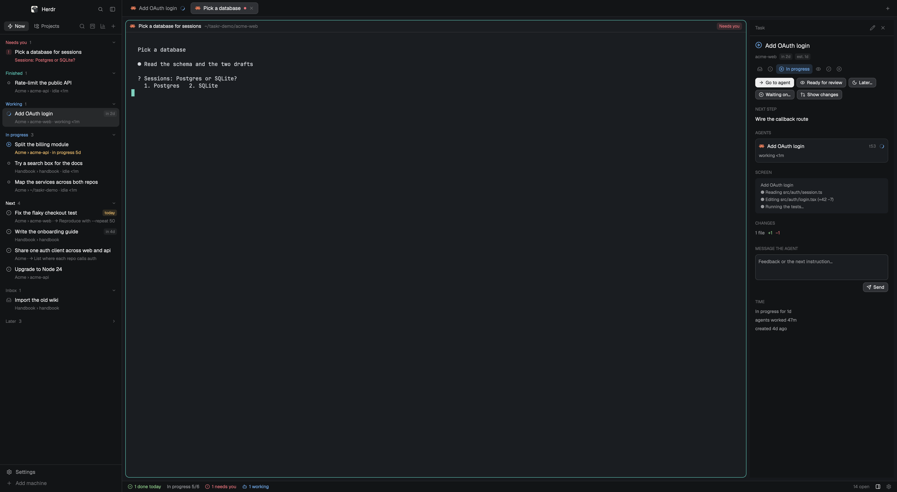
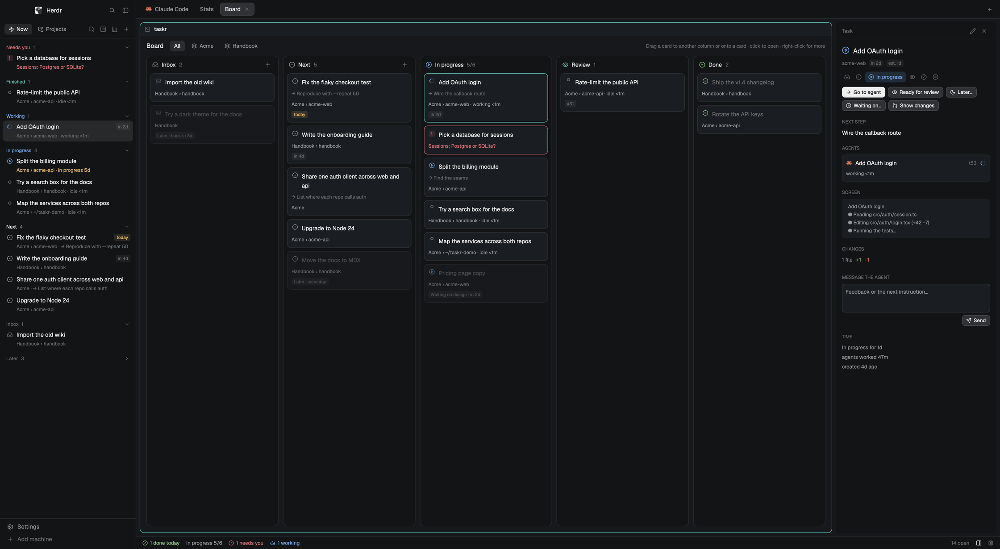

# taskr

**You plan. Your agents move the task. You close it.**
A light, local task manager for work done with coding agents, as a layout for the [Herdr app](https://herdr.dev):
projects → folders → tasks → the agents working on them, with what needs you first.

taskr was called tasker before 1.6. `./install.sh` moves an old install over: your tasks from `data/tasker`, your shortcuts from `layout:tasker`; `tasker.*` terminal labels are still read.

**[Website, tutorial and examples →](https://alex-roc.github.io/herdr-taskr/)**



Herdr already shows every terminal and agent you run. taskr adds the layer above them: *what are
these agents for?* Each tab can belong to a task; a task knows its folder, due date and
next step, and sits where you dragged it; and the list tells you what to do next: answer the agent that's waiting, review what one
finished, or start the next task.

What makes it different:

- **Tasks follow their agents, and you have the last word.** A task moves to In progress when its agent
  starts working; a finished turn isn't a finished task, so Review and Done are your call. No
  pipeline to configure.
- **Real planning, not just a list of agents.** Projects and folders, an order you set by dragging,
  due dates in plain words, and idle agents parked out of the way.
- **Light and local.** One mod and one JSON file you (or an agent) can edit. No service, daemon,
  account or extra CLI. GitHub and Linear are optional imports.

- [What you get](#what-you-get)
- [Install](#install)
- [Use it](#use-it)
- [Keys](#keys)
- [Your data](#your-data) · [For agents](docs/agents.md)
- [What it runs on your machine](#what-it-runs-on-your-machine)
- [Troubleshooting](#troubleshooting)
- [Tutorial](https://alex-roc.github.io/herdr-taskr/tutorial.html) · [Examples](https://alex-roc.github.io/herdr-taskr/examples.html)
- [Develop](docs/development.md) · [Recipe](RECIPE.md) · [Changelog](CHANGELOG.md)

## What you get

**Three questions, three owners.** Every task answers the same three, and each has one owner:

| Question | Words | Who says it |
|---|---|---|
| **Stage**: where is the work? | Inbox, Next, In progress, Review, Done (✗ when dropped) | You. Kept in the task; the board's columns |
| **Turn**: who moves now? | Working, Needs you, Finished (not seen yet), Idle (seen, waiting for you) | The agent, through Herdr. Live, never kept |
| **Parked**: when does it come back? | Later (a day, *someday*, or *until its agent works*), Waiting on someone | You park it; it comes back by itself |

The turn never writes the stage but for one thing: an agent starting work moves its task to
**In progress**. When it stops, the task stays where it is: a turn isn't the task. **Review** is when the
whole task is ready to check (*Ready for review* in the detail or its menu, or an agent writing it in
the file). A task is **Done** when you mark it, or when its agent quits and leaves only a terminal: a
terminal alone isn't a task. If you work with pull requests, a PR opened for a task with its own
worktree branch moves it to Review too.

**Now**: one list, in the order things move forward: what the agents ask of you, then what's yours to
do next, then what's parked. Each task once.

| Section | What's in it |
|---|---|
| **Needs you** | Tasks whose agent asks for you, with its question right in the row |
| **Finished** | Tasks whose agent finished its turn and waits for a word from you: a queue, the turn that ended last on top; the ones you haven't seen in bold. Seeing one doesn't move it: it goes down as other turns end. Only the turns you haven't decided on: change a task's stage after its turn ended (Next, to do it later) and it goes to that section, until another turn ends (an agent reopened after a restart hasn't ended one) |
| **Working** | Tasks with an agent at work |
| **Next** | What's yours to do, in the order you set (drag a row onto another): tasks in Next, and those in progress or to review with no agent at work or waiting for you |
| **Later** | Parked tasks, folded: each comes back on its day, when its agent works, or when you bring it back |

The **Inbox** (ideas and imported issues, not yet decided) waits in Projects and on the board until you
pick from it: move one to Next and it's in Now.

Under each row, and on each board card: where it is and how long its agent has been as it is
(`Acme › api · working 14m`). Where is the task's folder, else the one its terminal is in now,
else that folder (`General › ~` for a project's own space). An agent's question takes that line
when it needs you. A task in progress with no agent open says so (`no agent open · in progress 2h`).
Its model, effort and context are in the terminal's header and the detail.

Which stage when: **Inbox** not decided, **Next** you'll do it, **In progress** under way (`doing` in
the file: "in progress" isn't "being done right now", that's *Working*), **Review** ready to check,
**Done** closed, or **Dropped** (✗) if you won't do it.
Rows that are closed or parked are dimmed, unless their agent works or asks for you.

**What goes first is where you put it.** Drag a task onto another in a section of Now or a project
in Projects, and it takes that place (a line shows where it lands). `t`, or *Move to the top* in its menu, puts it first. New tasks go last.

**Park it** without changing its stage: right-click → *Later…* (`z`, or the detail) for tomorrow,
next week, *someday* or *until its agent works* at a click, or a day you type (`fri`, `+3d`, `12-24`);
or *Waiting on…* when it depends on someone, with who and a day to follow up (in three days unless
you type another). A parked task leaves Now's lists for its folded *Later*. On its day it comes back
with a notification (from waiting, with *Follow up with Ana* as its next step if it had none). Once a
day, a notification also tells you what's due or late (*Reminders* in the settings turns both off).

**Tasks or terminals, the same flow.** Every agent is a task. When one starts in a tab with no task,
taskr makes a task *with no plan* in progress, named after what the agent calls its work. A planned task
is the same thing with its plan filled in (next step, notes, due date…): *Plan it…* in the detail
opens its form. Change anything on a no-plan task and it's yours from then on.

A task lives with its agent: in progress while it's open, shown under Working or Finished as its
agent is. When its agent quits (30 seconds after) or its tab closes (a minute after), it goes to Done
(one in Review stays there), planned or not, and *Resume agent* picks it up: a terminal alone isn't a
task. A tab left open is a plain terminal again (`zsh · folder`), and an agent started in it again
takes the same task back up. A planned task you only opened a terminal for, with no agent ever,
stays as it is. After a restart, a planned task whose agent went meanwhile (its tab closed) closes the
same way, unless you moved or parked it since. An agent that resumes a task's conversation (by hand,
or after a restart) goes into that task, not a new one. With many agents open, *Park idle agents* in the settings (from an hour to a week;
off by default) parks any task whose agent has been idle that long, planned or not, until the agent works again.
*Done today* in the status bar counts the tasks you marked done, planned or not (not dropped ones, nor sessions that ended because their agent quit), and *turns today* the turns your agents finished. So you can work only with terminals and agents and still get the list, the board,
Later, the reminders and the resume after a restart; and plan tasks with details (next step, notes,
due date, issues, a worktree) when you want.

A terminal (a shell) isn't a task: it shows in Projects under its folder, or its project. A plain
terminal in no task has **Add to task…** in its menu. A task with tabs has **Move to task…**: it moves
its agent (tabs, conversations, agent time) into another open task, and the first task goes.

**Projects**: an outline of projects → folders → terminals and tasks. A folder is a git repository or not. A git
folder shows its branch, commits not pushed (↑) and uncommitted changes (•). From a folder: `+` a
task, `›_` a terminal there, and `⋯` (or right-click) the same, then importing GitHub or Linear
issues, moving it to another project, removing it from its project, or closing its spaces. A folder
in a project is only a pointer: no terminal and no task until you start something there. A project's
row glows under the pointer and shows its actions: `+` a task and `›_` a terminal for the whole
project, its board, and `⋯` (or right-click), its menu: the same three, then edit it, pause it, or
close all its spaces. An agent starts from a task (*Start agent*, or *Start with…* to pick which).
Done tasks are on the board; Projects shows open tasks, and a closed one only while its terminal is
still open. A **paused**
project waits folded under *Paused* at the end of Projects, and its tasks leave Now and the board of
every project, but for an agent that needs you or is working, and what you parked (it stays in
Later); *Make active* brings it back. Only you pause a project (idle agents are parked one by one
instead, with *Park idle agents*). Work for the whole project
(its terminal, its agents, a task with a project but no folder) opens in the project's own space,
named after it, in the nearest folder holding all its folders (`~/dev` for `~/dev/a` and
`~/dev/b`; your home folder while it has none, or when they share nothing below it), and shows at the project's level, above its
folders. An agent started there after a `cd` into another folder (a new one, say) goes under that
folder in the project instead, and a task with no plan keeps following its agent: quit it, `cd`
elsewhere and start another, and the task moves along (moved by hand, it stays where you put it). That folder shows there while it has tasks; its row's
*Add to project* button (a folder with a plus) keeps it in the project for good.

A Claude Code that reports no state to Herdr (it asks the terminal once, as it starts, and with no
answer in time, a dozen agents starting at once, stays silent) says *not reporting* on its row after a
minute; its card in the detail has **Restart**, which quits it and resumes the same conversation in its
terminal. Meanwhile taskr reads its state from its title. **Projects is an outliner**: drag a project's row onto another to reorder them; drag a folder
onto another folder and it takes that place (a line shows where it lands, in its own project or in
another), or onto a project's header to put it last there (*No project* takes it out); drag a task onto
a folder, a project's header (its own level) or a task elsewhere, and it moves there (a task with a
worktree stays with its folder). What's being dragged is dimmed, with what's in it. Its agent is told which
folders are the project's (any outside that folder is added with `--add-dir`, Claude Code and
Codex); a task in one folder of a bigger project hears of the others. Terminals show the same line as a task:
where they are and how long in their state. With no folder, a terminal opens in `~`.

**Each terminal's header** says what it's for: its task's title (else its program), the agent's
model · effort · context, its folder and state; split, zoom and close while the pointer is on it.
Click it to select its task.

**Board**: a kanban tab (`cmd-shift-b`, or the board button in the lists' header) with a column per stage: Inbox,
Next, In progress (parked cards dimmed, last), Review and Done (last 7 days). Drag a card to another column to change its stage, or onto another card to put it there; click to open it,
right-click for its menu. Every board is a tab: **Board** for every project, and **Board · Acme** for
each project, with only its tasks and agents. The pills at the top (All · Acme · …) go from one board
to another, opening its tab the first time.



**Task detail** (right panel, when you want more: the panel button in the status bar, `cmd-i`, `i`
or *Details* in a task's menu; selecting a task never opens it, and it stays as you left it): its stage,
*Ready for review* or *Mark done*, *Later…* and *Waiting on…*, the next step and notes; each agent with its
model, reasoning effort, context, turn and sub-agents, and the question it's waiting on; the last
lines of its screen; the changes in its folder and, for a task with its own branch, its pull request and CI checks (with
*Ask for a pull request* and *Send failed checks*); a box to **message the agent**; time in state and agent time
(and every change of stage, with *Activity in the details* on in the settings).

**Start agent** on a task opens your agent in the folder's space with the task (title, next
step, notes, issue) as its first message. **Start with…** (beside it in the detail, or in the task's
menu) picks the agent, its model (`opus`, `sonnet`, `fable`… for Claude Code; any model name for
Codex) and reasoning effort, and whether to start in a worktree; the task keeps the choice for its
next starts, and *Agent to start* in the settings is the default. **In a worktree** (or `w`) first
creates the branch `task/<name>` in `~/.herdr/worktrees/<repo>/<name>`, where Herdr's own worktree
tools find it. It's offered only when the folder is a git repository.

When an agent starts working, its task moves to **In progress** (from Inbox, Next or Done; one in Review
stays there while the agent fixes what you found). It goes to **Done** when you mark it, or when its agent quits and leaves only a terminal. **Delete** closes the task's tabs, and the agent in them, after the dialog says so. **Archive** puts its tabs away and can remove its
worktree (a branch with unmerged commits is kept).

**Resume agent**: taskr remembers the Claude Code or Codex conversation each task's agent was in.
After a restart, or once you closed its tab, *Resume agent* (or `r`) runs `claude --resume <id>` or
`codex resume <id>` in its folder, tied to the task again.

**Closing**: in the taskr layout, `cmd-w`, `cmd-shift-w` and the × on a pane's header don't close an
agent: Herdr would end its conversation with no question. A notice says to quit it first (`/exit`,
`ctrl-c`); click it to close anyway. The × on Herdr's tab bar (above the terminals) is Herdr's own
and still closes at once.

**Stats** (the chart button in the lists' header, *Stats* in a project's menu, or `taskr.stats`): a tab with today
or the last 7, 30 or 90 days, for every project or one. *Done* counts the tasks you marked done (not sessions that ended by themselves); *Worked
on*, the tasks whose agents worked (planned or not, every task counts alike); *Turns*, how many times an agent finished its turn; *Agent time*, how long they worked. A
chart per day for agent time, one for turns and one for done tasks, and a table by project (*Shown in
Stats* in the settings hides Done or Turns: its number, chart and column). Done tasks count
backwards from their history; agent time and turns are kept per day from 1.7 on (`work` on each task,
the last 120 days).

**Plan usage** in the status bar (off until you turn it on in the settings): `Claude 28% wk 34%`, `Codex 8% wk 12%`, amber from 70% and red
from 90%; hover for when each limit resets, click to look again.

Inspired by the task → worktree → review → ship flow of [Orca](https://github.com/stablyai/orca).

## Install

You need the Herdr app (0.1.13 or later). `git` is used for repository state and worktrees, and
`gh` (optional) for issues and pull requests.

**From the gallery**: find *taskr* at [herdr.dev/layouts](https://herdr.dev/layouts) and ask your
agent in Herdr to add it, or point it at this repository: *"add the layout at
github.com/alex-roc/herdr-taskr"*. Herdr's agents know how to install a shared layout.

**With the script**:

```sh
git clone https://github.com/alex-roc/herdr-taskr && cd herdr-taskr
./install.sh --keys    # the layout, its picture and theme, the mod, and its shortcuts
```

Then pick **taskr** in Settings → Look, or run `herdr-app do layout.switch '{"name":"taskr"}'`.
Your other layouts are untouched; switch back the same way.

- `./install.sh` alone skips the shortcuts. `--keys` adds a `layout:taskr` section to
  `keys.json` and never replaces a key you already bound there.
- Run it again to update. `./install.sh --uninstall` removes taskr and keeps your tasks.
- It copies instead of linking: Herdr only hot-reloads files saved inside its own folder.

**By hand**: copy `layouts/taskr.json` and `layouts/taskr.svg` to `~/.config/herdr-app/layouts/`,
`themes/taskr.json` to `~/.config/herdr-app/themes/`, and `mods/taskr/` to
`~/.config/herdr-app/mods/`. Check it with `herdr-app check ~/.config/herdr-app/mods/taskr`.

## Use it

1. **Add a project.** In Projects, the folder button makes one. *Add folder…* takes a repository, or a
   plain folder with no repositories inside, at once; pick a folder that holds several (`~/dev`) and its
   repositories are listed to tick, with a filter and *Add all*, or *Add <folder> itself*. Or drag a folder onto a project's header or among its folders, or right-click it →
   *Move to project…*; its tasks go with it.
2. **Add tasks.** `n`, the `+` in Now (it asks for the project), `+` on a folder or a project (it
   knows where), or *Import GitHub issues* / *Import
   Linear issues* from a folder's menu. A due date takes `today`, `tomorrow`, `fri`, `+3d`, `2w`,
   `12-24` or `2026-12-24`.
3. **Start an agent.** `l` (or ▶ on hover, or *Start agent* in the detail) starts your agent with the
   task as its first message; `w` does it in a new worktree. The new tab is tied to the task.
4. **Already working?** Your agents' tabs are tasks already, with no plan, in progress. Open one's detail
   and press **Plan it…** to give it a next step, notes or a due date.
5. **Work from Now.** Answer what needs you, look at what finished, and when the whole task is ready,
   *Ready for review* (*Show changes* is in the detail), then `space` to mark it done.

Settings (the gear in the status bar): Now and Projects as tabs or **stacked** (both at once, one
above the other, as Herdr's spaces and agents), which agent *Start agent* runs, whether tasks whose agent stays idle get parked (*Park idle agents*), whether
the detail lists every change of stage (*Activity*, off by default), what the status bar shows (done
today, working, open tasks) and whether it shows plan usage, in groups. Stacked, `tab` moves the keys between the two lists; the chevron by a list's name folds
it to its header (the other takes the room), and a double click on the name gives it all the room. Stacked, find a task, the board and Stats
are in Projects' header (Now keeps its +); as tabs, in either.

**After a restart**: Herdr brings every terminal back, as a shell in its last folder. taskr
remembers which Claude Code or Codex conversation each one had (`data/taskr/terminals.json`), and
in a terminal that comes back as a fresh shell it types `cd <folder> && claude --resume <id>` (or
`codex resume <id>`), with a notification. Quitting an agent yourself isn't undone. *Agents after a
restart* in the settings turns it off. Agents that report no state to Herdr (Claude Code attached to
its background session with `claude attach`) still show as agents, with their model and context;
whether they work or stopped is read from their terminal's title.

**Linear** (optional): create a personal API key (Linear → Settings → Security & access → Personal
API keys) and either export it as `LINEAR_API_KEY` in your login shell profile or save it alone in
`~/.config/herdr-app/data/taskr/linear-key`. *Import Linear issues* lists your open issues assigned
to you, most urgent first, with their due date. taskr only reads from Linear.

## Keys

With `./install.sh --keys` (only while the taskr layout is shown):

| Key | Does |
|---|---|
| `cmd-j` | Move the keyboard to the task list |
| `cmd-k` | Find a task |
| `cmd-shift-n` | New task |
| `cmd-shift-o` | Switch Now ⇄ Projects |
| `cmd-i` | Show or hide the task detail |
| `cmd-shift-b` | Open the board |
| `cmd-w` | Close the tab, unless an agent is open in it (quit it first: `/exit` or `ctrl-c`) |
| `cmd-shift-w` | Close the pane, likewise |

In the list: `j`/`k` or arrows move, `enter` goes to the task's agent, `space` marks done (again: back
to Next), `t` to the top, `n` new, `e` edit, `l` start agent, `w` start in a worktree, `r` resume
its agent, `z` later, `i` details, `/` find, `tab` switches view. Clicking a task shows it and brings its agent's tab (or its
terminal) to the front. Right-click a task, a folder or a project for its menu.

From a script or an agent: `herdr-app do taskr.new`, `taskr.board`, `taskr.stats`, `taskr.view`, `taskr.jump`,
`taskr.settings`, `taskr.linear` (import Linear issues), and `taskr.select:<task id>` (shows that task).

## Your data

Everything lives in `~/.config/herdr-app/data/taskr/tasks.json`: plain JSON that you, or an agent,
can edit. taskr reloads it within a second of a save, checks every field, and never writes over a
file it can't read (it shows what's wrong instead). It never goes in this repository.

```jsonc
{
  "settings": { "agent": "claude", "usage": false, "reminders": true, "activity": false, "park_after": 0 },  // agent: a key from Herdr's agent menu; park_after: minutes a task's agent stays idle before it's parked (0: never)
  "projects": [{ "id": "p1", "name": "Acme", "folders": ["~/dev/acme"], "paused": false }],
  "tasks": [{
    "id": "t1", "title": "Add OAuth login", "project": "p1", "folder": "~/dev/acme",
    "status": "next",            // its stage: inbox | next | doing (In progress) | review | done
    "outcome": null,             // "dropped": closed without doing it (status done)
    "rank": 4,                   // its place in every list, lower first (set by dragging; leave it out: last)
    "due": "2026-11-20", "estimate": "2h", "next_step": "Wire the callback", "notes": "",
    "snooze": null,              // parked: "YYYY-MM-DD" (back that day), "someday", or "agent" (until its agent works)
    "waiting_on": null,          // with snooze: waiting on someone ("Ana", or "" for anyone)
    "issue": { "source": "github", "number": 12, "url": "https://github.com/…", "body": "…" },  // Linear: "number": "ENG-12"
    "worktree": null, "branch": null,
    "agent": "codex", "model": "gpt-6.1-sol", "effort": "high",   // optional: how Start agent starts it (Start with…)
    "work": { "2026-11-14": [3600000, 4] },   // its agents' work per day for Stats: [ms, turns], kept by taskr
    "auto": false,               // true: a task with no plan, made for an agent; any change of yours drops it
    "freed": false,              // with auto: its agent quit and its tabs are terminals again
    "tabs": ["<herdr tab id>"], "agent_ms": 0, "history": [{ "s": "next", "at": 1794000000000 }],
    "sessions": [{ "app": "claude", "id": "<session id>", "cwd": "~/dev/acme", "at": 1794000000000 }]
  }]
}
```

Only `id` and `title` are needed for a new task; everything else gets a default. Old files are still read: `repos` and `repo` as `folders` and `folder`, `deleted: true` tasks are dropped, and from before 1.7, status `dropped` as Done with `outcome: "dropped"`, status `waiting` as Doing parked waiting on someone (back three days after it began waiting), a no-plan task that was Idle as parked until its agent works, and `review_after` as `park_after`; from before 1.7.9, `wip`, `stale_days` and `pause_after` are dropped and a project taskr paused by itself stays paused, as one you paused. A task's tabs are
also labelled on their terminals (`taskr.task=<id>`, see `hc ls`; old `tasker.*` labels are still read), so a task finds its agents again
even if the file loses them. Agents that should add or move tasks: see **[docs/agents.md](docs/agents.md)**.

## What it runs on your machine

The mod runs these programs, only on your machine (or the machine a space lives on):

- `git`: read-only status and diffs, without taking locks; `worktree add`, `worktree remove` and
  `branch -d` only when you ask for a worktree or archive one.
- `gh`: `issue list` and `pr view`, when you import issues or look at a task in review.
- `hc` (Herdr's core): read an agent's last screen lines, send it your message, label terminals.
- `tail`, `grep` and `lsof`: to read the model, effort and context of Claude Code
  (`~/.claude/sessions`, `~/.claude/projects`) and Codex (`~/.codex/sessions`) from their own logs.
- `open` (`xdg-open` on Linux) for issue and pull request links.
- Your `claude` CLI, for a moment every 5 minutes while the window is in front, to ask for plan
  usage (`mods/taskr/bin/claude-usage.sh`): the CLI signs in by itself, taskr reads no token or
  credential file, and no prompt is sent. Codex's limits come from its own logs. Turn it off in the
  settings.

Its only request of its own goes to `api.linear.app`, and only when you open *Import Linear issues*.
Nothing else is sent anywhere. While the window is in the background, or the detail panel is closed,
it looks less often or not at all.

## Troubleshooting

- **The list says tasks.json can't be read.** The file has a JSON error (often a hand edit): fix
  it and save; taskr picks it up. Nothing was overwritten.
- **No model or effort on an agent.** Only Claude Code and Codex write them where taskr can read
  them. They appear after the agent's first reply.
- **A launched agent isn't tied to its task.** taskr looks for the new tab for 30 seconds. Use
  **Move to task…** on the tab, or add its tab id to the task's `tabs`.
- **Claude's usage shows `!`.** Hover it for the reason. taskr asks your `claude` CLI (`claude -p`
  with a usage request); an old CLI, or an account without plan limits, has nothing to report.
- **Resume agent doesn't appear.** taskr learns a task's conversation while its agent runs (Claude
  Code and Codex only); a task whose agent never ran under taskr has nothing to resume.
- **Changes in a mod file don't show up.** Run `./install.sh` again: Herdr doesn't reload a mod
  folder that is a symlink. `herdr-app status` lists any error.
- **Stuck in a broken layout.** `ctrl-alt-shift-escape` always goes back to Herdr's default layout.

## License

[MIT](LICENSE). Icons are [Lucide](https://lucide.dev) (ISC, `mods/taskr/icons/LICENSE`).
