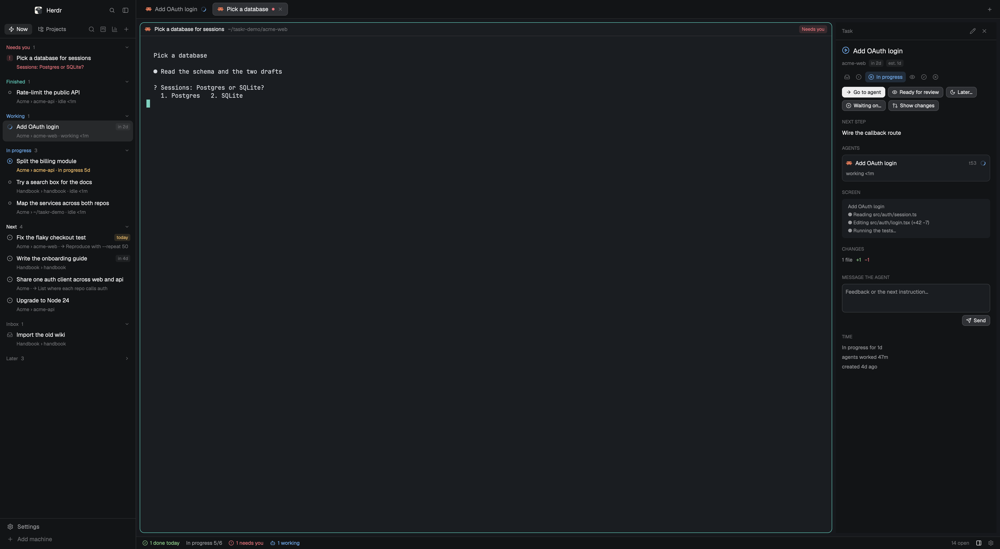

# taskr

A task manager for work done with coding agents. The left sidebar lists what needs you now, or an
outline of projects → folders → terminals and tasks; the right panel shows one task with its agents (model,
effort, context), its changes and pull request, and a box to message the agent; a board tab shows
every task by stage.

## What you see

- **Left sidebar, 330px** (`chrome` background), from Herdr's main layout: the brand row (46px,
  `workspace-chrome`), the taskr list, the footer (69px, `workspace-chrome` with `footer: true`).
  - Header (40px, border below): two pill buttons **Now** (zap icon) and **Projects** (folder-tree),
    24px high, the shown one on `selected`; then 22px icon buttons with tooltips (pressing one never
    starts a drag of its row): (Projects only) folder-plus "New project"; (Now only) square-kanban "Board", the
    board of every project (in Projects, each project's row has its own); search "Find a task"; (Now
    only) plus "New task" (in Projects, tasks are made from a project's or a folder's own plus).
  - **Now**: collapsible sections, header 11px medium in the section's color plus a count and a
    chevron, each task in one (`nowSection` in `lib/flow.js`): what the agents ask of you, then the
    stages, then what's parked. Needs you (`blocked`: its agent asks), Finished (`done`: its agent
    finished its turn, unseen ones first and in bold, then the Idle ones it waits on you), Working
    (`working`), To review (`done`), In progress (`working`: stage `doing` with no agent working or
    waiting for you), Next (foreground, first 7, then "N more" which opens Projects), Inbox (`dim`,
    first 5). Last, **Later** (`dim`, folded until opened): parked tasks, soonest back first, then
    *until its agent works*, then *someday*.
    Empty: "Nothing needs you. Press n for a new task, or open Projects to see your folders."
  - **Projects**: a project row (`layers` icon 13px, `dim` when paused; name 12px semibold, count of tasks and
    terminals, chevron); under it the tasks without folder, then folder rows (chevron, `folder` icon, name,
    `⎇ branch`, `↑ahead`, `•dirty` in `ansi3` (the three only for git folders), "not open" when no space is in it, each with a
    tooltip; then `plus` new task, `square-terminal` new terminal, `ellipsis` menu), the
    folder's tasks, and its terminals (shells, which are not tasks). It's an outliner: a folder row
    dragged onto another takes that place (a 2px `accent` line above, below when it comes from above
    in the same project), reordering the project's `folders` or moving it into another project there;
    onto a project's header (lit `selected`) it goes last in that project (No project: out of every
    project). A task dragged onto a folder (lit), a project's header (its own level) or a task in
    another folder moves there (`moveTaskTo`; not one with a worktree). What's dragged is at 0.45 with
    what's in it; the click that ends a drag doesn't fold or select. Open git repositories and folders in no project go
    under "No project". A project row glows `hover` under the pointer, and its count gives way to its
    actions: `plus` (a task for the whole project), `square-terminal` (a terminal for the whole
    project), `square-kanban` (its board) and `ellipsis` (its menu). Projects shows open tasks, and a
    closed one only while its terminal is open (the board's Done column has the rest). A press on a
    row becomes a drag only once the pointer moves 4px within 1.5 s; leaving the list ends a drag. Dragging a project row onto another moves it
    there (dimmed while dragged; a 2px `accent` line above or below the target shows where it lands);
    the order is `projects` in tasks.json. Paused projects (`paused: true`) come last, under a
    **Paused** section header (`dim`, folded until opened, as Later). A project pauses by itself after
    `pause_after` days (setting; 1 by default, 3, 7, 14, 30, 0 for never) with no task changed and no
    agent working or asking (`paused_auto` marks it; `active_at` is when it was made or made active), and
    comes back by itself at the next sign of life; a pause of the person's stays. No project colors: a `color`
    from before stays in the file, unused.
  - **Stacked** (`taskr-split`, Projects over Now, each block `min` 41): each list's header has a
    chevron by its name; folding sets its block to `px: 41` (its header) and the other to `weight: 1`,
    unfolding back to `weight: 1` (Herdr then drops the size it kept). Never both folded; a double
    click on a name folds the other. Which one is folded: `shared("taskr.stackFolded")`.
  - **Order**: every task has a `rank` (lower first); every Now section but Later, each project's
    and folder's tasks and every board column follow it (Projects: open tasks first). Dragging a task
    row onto another in the same list (or between Inbox and Next, which also changes its stage)
    puts it at that place: dimmed while dragged, a 2px `accent` line above the target (below when
    it comes from above), no line where it can't land; the list's tasks share out the ranks they
    had, so nothing outside it moves. `t` or *Move to the top* (arrow-up-to-line) puts it first. A
    new task goes last; one written without a rank goes last, or first with `"priority": 1`/`"high"`
    (a file from before ranks keeps its priority, due date, oldest order).
  - **Task row**: 16px mark (the lead agent's turn as Herdr draws it: spinner, "!" on
    `blocked`+26 alpha, 7px dot `done`, ring `idle`; else the stage icon: inbox, circle-dot,
    circle-play, eye, circle-check, circle-x for dropped), title (semibold when its agent finished and
    you haven't seen it), due chip ("2d late" on `blocked`, today/tomorrow on `ansi3`, else `dim`).
    A second 11px line: the agent's question in `blocked`, else where it is and its agent's time
    ("Acme › app · working 4m", "finished 3m ago", "idle 1h", "needs you 2m"), else "Later · back fri",
    "Waiting on Ana · fri" or "Later · until its agent works" for a parked task, else "→ next step"; a
    task in progress that hasn't moved for `stale_days` (no change, no agent at work) shows "in
    progress 5d" and the line in `ansi3`. The title is `dim` when the task is aside (`aside()` in
    `lib/util.js`: closed or parked), unless its agent works or asks;
    the board dims the same cards (title `dim`, card at 0.6 but in Done). Hover shows a play
    button on tasks without an agent. Selected row on `selected`.
  - **Terminal row** (a shell in no task): terminal icon, its name (the tab's name, else "zsh ·
    <folder>", never the address) and a second line like a task's. Right-click: a popup (240×150) with
    Add to task… (the find dialog in attach mode: open tasks only, picking one ties the tab to it) and
    Go to terminal. A task with tabs has *Move to task…* in its menu: the same dialog in merge mode,
    which moves its tabs, `sessions` and `agent_ms` into the task picked and removes the first.
- **Two lists at once** (optional): the list block sits in a stack `taskr-lists` whose other child,
  `taskr-split`, is a column of two blocks with `view: "projects"` (top) and `view: "now"` (bottom),
  weight 1 each, min 90px. A list with a `view` shows its name (icon + "Projects"/"Now") instead of
  the two pills. The settings pick the child with `layout.select`.
- **Right column `taskr-detail`, 360px, hidden until opened** (status-bar button, cmd-i, `i`,
  *Details*, or a card clicked on the board; selecting a task never opens it): header "Task" with pencil
  and ✕; title 15px with its stage icon; folder, due chip, parked chip, "est. 2h", issue link; a row of
  stage icons (Dropped last) where only the current one shows its name; actions (Plan it… on a task
  with no plan, which opens its form; Start agent (tooltip: its agent · model · effort) and Start
  with… (settings icon), or Go
  to agent; with no agent and a remembered conversation, Resume agent first (rotate-ccw, tooltip
  "Continue its last Claude Code conversation (2h ago)"); Ready for review (eye) in progress, Mark done
  in Review; Later… (moon) and Waiting on… (circle-pause), or Bring back when parked; Show changes);
  sections in 10.5px uppercase `dim`:
  Next step, Notes, Agents (cards: program icon, title, address, state, "opus 5.5 · medium · ctx
  248k · turn 7 · working 1m", the pending question, sub-tasks and sub-agents as a tree), Screen
  (last 8 non-empty lines of the agent's terminal), Changes ("N files +add −del"; for a task with
  its own branch: the branch, PR chip that opens the PR, checks chip, "Ask for a pull request", "Send
  failed checks"), Message the agent
  (textarea + Send), Time ("In progress for 2h", "agents worked 47m", "created 4d ago"), and with
  *Activity in the details* on (off by default) Activity (history, newest first).
- **Board** (a tab whose only pane is the mod with `role: "board"`, named "Board"; a project's own
  board is another tab, "Board · <project>", with `project: <id>` in its props, its tasks and agents
  only. Every board's header has the pills All + each project (the current one on `selected`); a pill
  goes to that board's tab, made when not open (tabs are found by name); an open one is focused instead of
  making another): header 44px on `canvas` with "Board", project pills (All + each project, `layers`
  icon) and a hint; five columns, one per stage, that share the width (min 170, max 320px) on
  `chrome`, radius 10, header 38px (stage icon, name, count; In progress shows n/limit, parked cards
  not counted, in `ansi3` when over; + on Inbox and Next); cards on `background`, radius 9, border
  `blocked` when the agent needs you, `accent` when selected: mark + title, next step, the question or
  "Acme › app · working 4m" (where, as in Now; a project's board leaves the project out), chips (due,
  parked, #issue, branch). Parked cards are at 0.6. Dropped tasks aren't on the board. Empty column: a
  56px "Nothing here" box. Done shows the last 7 days. Dragging dims the card and highlights the
  column under the pointer (`selected` + `accent` border); releasing there sets the stage. Held over a
  card, a 3px `accent` line shows where it lands (below when it comes from above in the same column);
  releasing there sets that column's stage and puts it at that place.
- **Stats** (a tab, the mod with `role: "stats"`, named "Stats"; opened from Now's header
  (`chart-column`), a project's menu (that project picked) or `taskr.stats`; one tab, a pick sent
  through `shared("taskr.statsPick")`): header 44px on `canvas` with "Stats", period pills Today / 7
  days / 30 days / 90 days (remembered per copy) and project pills (All + each active project);
  four tiles on `chrome` (Done: tasks closed by the person, planned, not dropped; Worked on: tasks
  whose agents worked, "N with no plan"; Turns; Agent time); with more than a day, two bar charts,
  one measure each (agent time per day in `working`, done per day in `done`): bars 2px apart, max
  28px wide, rounded tops, the tallest 72px, an empty day a 1px `border` line, a tooltip per bar
  ("11/14: 2h 5m"), first and last day under them; with All, a table by project (Done, Worked on,
  Turns, Agent time; by agent time). Work per day lives on each task, `work: { day: [ms, turns] }`
  (last 120 days, `lib/stats.js`): the books split agent time at midnights and count a turn when a
  working agent finishes or rests. When the period reaches before the first day kept, a dim line says
  since when.
- **Status bar, 28px**: "✓ N done today" (`ansi2` when > 0; not no-plan or dropped tasks), "In
  progress n/limit" (parked tasks don't count; `ansi3` and "finish something first" when over), "! N need(s) you" (click: Now), "N working" (both count open tasks, as Now's sections do); on the right plan usage
  "Claude 28% wk 34%" and "Codex 8% wk 12%" (`muted`, `ansi3` from 70%, `blocked` from 90%, by the
  fuller limit; tooltip with reset times; click looks again; "Claude !" with the reason on error),
  "N open", a `panel-right` button that shows or hides the detail (`foreground` when shown) and a
  settings gear. Plan usage is off until turned on.
- **Dialogs** (Herdr dialogs, `popover` background): task form 560×660 (its project picker leaves
  paused ones out), project 500×620 (name; State: Active / Paused; the project's folders only,
  each with ✕; *Add folder…*: the system's picker, a repository or a plain folder with no repositories
  inside goes in at once, a folder that holds repositories (a `.git` folder each) lists them to tick, with a filter
  past 8, *Add all N* and *Add <folder> itself*), settings 480×1180, find 520×420, issues
  540×460, archive 460×230, delete 420×190, close 440×200, later 470×260; menus are popups (task
  280×450, folder 250×370, project 280×380, move a folder 260×320, terminal 240×150). Forms scroll and keep their
  buttons in a footer with a border.
- Theme: `themes/taskr.json` for dark (`#1a1d21` background, teal accent `#5fc4b5`, `working`
  `#6fa8e8`, `blocked` `#e5737b`, `done` `#5fc4b5`), Herdr's `paper` for light.

## How it behaves

- Three questions, each with one owner (`lib/flow.js`, plain functions with their tests). The
  **stage** (`status`: inbox, next, doing shown as In progress, review, done; Dropped is done with
  `outcome: "dropped"`) is the person's, kept in the file. The **turn** is the agent's, from Herdr,
  never kept: working (spinner), blocked (Needs you, with its question), done (Finished, unseen), idle
  (seen, waiting for a word from you). A task's turn is its most urgent agent's, sub-agents included.
  **Parked** (`snooze`: a day, `someday`, or `agent`, until its agent works; with `waiting_on`, waiting
  on someone) is the person's too, and comes back by itself; it doesn't change the stage and leaves
  the in-progress count.
- The turn writes the stage only when an agent starts working: inbox, next or done (not dropped) →
  doing; review stays review (fixing what a review found is part of it). A finished turn moves
  nothing. Review is the person's (*Ready for review*) or an agent's (writing the file); a pull
  request opened since the task went in progress moves it to review, only for a task with its own
  worktree branch (looked for every 3 min with the window in front; nothing else asks `gh` in the
  background). Nothing becomes done by itself but a task with no plan whose agent quit. Agent working
  time adds up per task. The list copies do this bookkeeping, their state shared (`globalThis`) so two
  lists on screen record each change once.
- A task with no plan (`auto: true`, see Terminal tasks below) is made in progress (`adoptStage`) and
  stays there while its agent is open, shown under Working or Finished as its agent is. When its agent
  quits (30 s) or its tab is gone (1 min) it goes to done (`quitStage`: one in review stays), with
  `freed: true`: it lets go of its tabs (`released` in `lib/world.js`: not in `taskOfTab`, no agents,
  `live` empty), so a tab left open shows as a terminal row, and `adopt` takes the same task back up
  when an agent starts there again. With `park_after` (minutes: 60, 240, 1440; 0, never, by default)
  a task with no plan whose agent has been idle that long is parked until it works (`parkDue`).
  "Done today" doesn't count no-plan or dropped tasks.
- Parked: on its day it comes back (snooze cleared) with a notification; back from waiting on
  someone with "Follow up with Ana" as its next step when it had none. `agent` comes back when its
  agent works or asks. In progress and done clear it.
- Clicking a task selects it and focuses its agent's pane (else a terminal of its tabs); Enter does
  the same, and opens the task form when it has neither.
  Right-click: a task's menu (details, edit, start, start in worktree, stage icons and Dropped, move to
  the top, Ready for review in progress, Later… and Waiting on… (plain items: a dim label beside
  chips read as disabled), Bring back, move to task, archive, delete in `blocked`); the Later dialog:
  quick buttons Tomorrow / Next week / Someday / Until its agent works, then "Or a day" to type, and
  *Park*; Waiting on…: who (optional) and the day to follow up (+3d unless typed); a folder's
  menu (new task, new terminal; import GitHub issues, import Linear issues; *Move to project…*, a list of every project (paused last) and No project, also done by dragging the
  folder's row onto a project's header (the row dims, the header gets `selected`; its tasks follow); *Remove from
  <project>*, `folder-minus`, which keeps its tasks in the project); a project's menu (header: layers
  icon, name, "2 folders"; New task…, Terminal (the folder it opens in, `~/dev`, on the right),
  Board; Edit project…, Pause project / Make active, Close project…). No list of every agent in
  either: an agent starts from a task, and *Start with…* (dialog 480×420: Agent pills, the default
  first; Model, an input plus Claude Code's aliases fable / opus / sonnet / haiku; Reasoning effort,
  low…max for Claude Code, low…xhigh for Codex; Where, in its folder or in a worktree) saves `agent`,
  `model`, `effort` on the task and starts it: `--model`/`--effort` for Claude Code, `-m` and
  `-c model_reasoning_effort=` for Codex, nothing for other agents.
- A row's place: the task's folder, else the folder its terminal is in now (a task of a
  project's own space, its agent in `~/dev/x`), else that folder, `~`-shortened. The sidebar looks
  up those folders with the spaces' (RepoCache, shared).
- Reminders (on by default): a notification for parked tasks back on their day, and once a day (`reminded`)
  for what's due today or late; one notification for several; clicking it runs `taskr.select:<id>`
  (or `taskr.focus`).
- A task for the whole project (a project, no folder) and a project's own terminals and agents
  run in the project's own space (named after it) in the nearest folder holding all its folders
  (a lone folder's parent; the home folder for a project with none, or whose folders share
  nothing below it), with `--add-dir` for any
  folder outside it (Claude Code and Codex);
  the first message names every folder of the project. Their terminals are labelled
  `taskr.project=<id>` and their tabs show at the project's level, above its folders, never
  under a folder or No project. Close project closes that space too. A task in one folder of a bigger project hears of the others.
- Close folder / Close project: one confirmation ("Closes its 2 spaces … and 1 agent"), then
  `space.close {confirmed: true}` for each space open in those folders. With no folder, a terminal opens in `~`.
- Delete and archive ask first. Delete says it closes the task's tabs and the agent in them, then does, and removes the task from tasks.json (no `deleted` tombstones; old ones are dropped on read); archive marks it done,
  settles its tabs and can `git worktree remove` + `git branch -d`.
- Start agent: `tab.new` in the folder's space named after the task with the task as its first
  message (or `space.new`); the new tab (one named like the task first, never one already a task's)
  is tied to the task and its terminals labelled `taskr.task=<id>`. In a worktree: `git worktree add
  -b task/<slug> ~/.herdr/worktrees/<repo>/<slug>` first (`<slug>-<id end>` if another task has it).
- Task form: title (required: Save is dimmed without it); the project only for a new task from Now
  (from a project or a folder the title says where, "New task · Acme"; editing doesn't move a task to
  another project: drag it in Projects); folder ("The whole project", or one of its folders; open
  folders when it has no project); stage (a new task: Inbox or Next; editing: every stage and
  Dropped); due (today, tomorrow, fri,
  +3d, 2w, 12-24, 2026-12-24, with "in 3d · 2026-11-10" beside the label, red border when not
  understood), estimate, next step, notes. Enter saves once.
- Settings: Park idle agents (never, 1 h, 4 h, a day; `park_after`), Now and Projects (Tabs / Stacked,
  when the layout has `taskr-lists`), Pause quiet projects (never, 1, 3, 7, 14, 30 days;
  `pause_after`), steppers for the In-progress limit (1–20, `wip`) and Days without movement (1–60,
  `stale_days`), Agents after a restart, Reminders, Activity in the details (off by default) and Plan
  usage (off by default) On/Off,
  and the installed agents as pills (the chosen one stays even if not installed).
- Resume: while a local Claude Code or Codex agent runs, its session id and folder are kept on the
  task (`sessions`, newest 5). Resume runs the agent's `run` + `--resume <id>` (Codex: `resume <id>`)
  in that folder, with no first message, through the same launch-and-tie path as Start agent.
- Terminal tasks (every agent is a task; `sidebar.js` `follow()`, `adopt/merge/remove` in
  `lib/actions.js`): the bookkeeping adopts every tab with an agent and no task as a task with
  `auto: true` (no plan; in progress; a tab opened for a project goes to that project with no
  folder). While `auto`, its title follows the agent's own title, and it goes to done (not removed,
  one in review stays) 30 s after its agent quits (no agent left in its tabs: Herdr's listed agents
  whose terminal has its own shell in front again, `shellOnly` in `lib/world.js`, don't count) or a
  minute after its tab is gone from every space (not counting away machines or no spaces at all).
  After a restart the resume typed by `lib/revive.js` brings the agent back before that. Any change the person makes (form, menu, keys, detail, board, Later, a drag) drops
  `auto` (`kept()`). A shell isn't a task.
- Agents after a restart (`lib/revive.js`, setting `revive`, on by default): for each local terminal
  with a Claude Code or Codex agent in front and a transcript, `data/taskr/terminals.json` keeps
  `{pid, tab, app, id, cwd, at}` by address. A terminal at that address, in that tab, with another
  pid and no agent in front (Herdr recovered it as a shell) gets `cd '<cwd>' && <resume>` through
  `env -u HC_TERMINAL_ID hc send`, once, and a notification. The same shell alone in front for 10 s
  (quit by hand) forgets it; another tab at the address forgets it; 14 days old, forgotten.
- A pane whose program isn't a shell and is an agent by Herdr's table, its report or its key
  (claude, codex) counts as an agent even when it reports no state (`claude attach`). Its state comes
  from its title as the core has it (`hc get`: Herdr strips the mark for mods), every 3 s with the
  window in front, a change redrawing every copy: ◐◓◑◒ or braille first is working, ✳ idle, else
  `unknown` ("running 4m"). Its session comes from `~/.claude/projects/<folder>/<attach id>*.jsonl`.
- Import issues: GitHub (`gh issue list`) or Linear (GraphQL `viewer.assignedIssues`, not completed or
  canceled, with a personal API key from `$LINEAR_API_KEY` or `data/taskr/linear-key`; imported
  most urgent first by Linear's priority, due date kept). Issues already imported (same URL) are hidden.
  Linear issues show as "ENG-12", GitHub ones as "#12".
- Keys in the list: j/k, arrows, enter, space, t (to the top), n, e, l, w, r, z (later), i (details), /, tab
  (with two lists: to the other one). Layout keys: cmd-j, cmd-k,
  cmd-shift-n, cmd-shift-o, cmd-i, cmd-shift-b. Mod commands (`taskr.new` …): `new`, `jump`, `board`, `view`,
  `focus`, `settings`, `linear`, `select:<id>` (selects it and opens the detail: scripts and
notifications ask for it). With two lists on screen, Now acts on them and sets agent.next/prev.

## Built from

- Layout: Herdr's `main` with `sidebar-lists` replaced by the stack `taskr-lists` (a block `{mod:
  "taskr", props: {role: "sidebar"}}`, and the `taskr-split` column of two lists), a hidden column `taskr-detail` (`role: "detail"`) appended to `work-body`, and the
  status block given `role: "status"`; root `"preview": "layouts/taskr.svg"`. Kept:
  `workspace-chrome`, `tabs`, `files`, `changes`. The pane header is taskr too (`{mod: "taskr"}`,
  no props: Herdr hands it `{pane, terminal}`): program icon, the task's title (else the program),
  model · effort · ctx in `muted`, the folder in `dim`, the agent mark; split right/down, zoom and
  close (Lucide columns-2, rows-2, maximize-2/minimize-2, x) while hovered.
- One mod, `taskr`, roles by props (sidebar, detail, status, board, stats, pane); dialogs are the same mod as overlays with `{dialog: "task" |
  "project" | "menu" | "repo" | "project-menu" | "jump" | "issues" | "archive" | "confirm-delete" |
  "confirm-close" | "later" | "start" | "settings"}`,
  opened through one function that holds their sizes.
- Data in `data/taskr/tasks.json` (moved from `data/tasker` on first start; terminal labels `taskr.task` and `taskr.project`, the old `tasker.*` still read; projects hold `folders`, tasks a `folder`, old `repos`/`repo` read and rewritten): `readTextFile`, every task and project cleaned on read,
  `writeTextFile` compare-and-swap with retries, never over a file that doesn't parse, `watchFolder`
  to reload. Cross-copy state: `shared("taskr.selected")`, `shared("taskr.view")`,
  `shared("taskr.pending")` (launches waiting for their tab); caches on `globalThis` (agent info,
  repository state, since-when) so every copy looks once.
- `spaces()`, `panes()`, `agents()`, `terminals()` joined per render; `setAgentOrder` follows the
  list. Since when: `status_ms`, else the tab's `working_since` / `changed_at`, else taskr's stamp.
- `layout()` tells whether `taskr-detail` is on screen (a stack shows only its `active` child): the
  detail reads `hc read`, `git diff` and `gh pr view` only then, every 15 s with the window in front
  (PR every 60 s), and redraws only when what it read changed; it skips `hc read` while the agent's
  terminal has the focus. Agent info, repository state and plan usage redraw only on news too: every
  redraw of a mod redraws the whole window.
- Model, effort and context: Claude Code `~/.claude/sessions/<pid>.json` → transcript, searched
  with `tail -c 4MB | LC_ALL=C grep -aoE` for the last `"model"`, `"effort"` and usage counts (16 MB
  if not found); Codex rollout via `lsof -p <pid>` → `turn_context` and `token_count`; on another
  machine, that machine's `$HOME`.
- Plan usage (`lib/usage.js`, status bar copy only, every 5 min with the window active): Claude via
  `mods/taskr/bin/claude-usage.sh`, which starts `claude -p --safe-mode --no-session-persistence
  --input-format stream-json --output-format stream-json` and writes one control request
  `{"type":"control_request","request":{"subtype":"get_usage"}}`, reading `rate_limits.five_hour`
  and `seven_day` (`utilization`, `resets_at`) from the `control_response`; Codex from the last
  `rate_limits` (`primary`/`secondary`: `used_percent`, `window_minutes`, `resets_at`) in its 3 newest
  rollout logs. A window whose reset passed counts as 0%.
- Programs: git, gh, hc, tail, grep, lsof, open/xdg-open, claude (usage only); fetch to Linear.
- Icons: Lucide SVGs in `mods/taskr/icons` (status, header, folder and menu icons, settings,
  trash-2, circle and circle-check for checkboxes).

## Watch out

- Herdr does not hot-reload a mod folder that is a symlink: install by copying.
- `child(null)` throws; a helper that may return nothing (the due chip) must be guarded.
- Claude Code transcripts carry multi-megabyte lines (pasted images): parsing a fixed tail as JSON
  lines finds nothing. Grep the fields; keep it to a few MB with `LC_ALL=C`.
- `terminals()` doesn't always carry `status_ms`; every copy stamping its own "since" makes the
  views disagree: share it.
- `hc read` output carries "[hc] …" notes; drop them. Shell titles are often the terminal address.
- The tabs mod re-hides the `panel` column per space, so the detail lives in its own column.
- Herdr already notifies blocked and done agents; taskr adds no toasts for them.
- Closing an overlay drops that copy and the work it spawned: a dialog writes first, then closes.
- Key commands reach every shown copy: with two lists, only Now acts.
- A store write that fails redraws once for the message, not on every retry (a render that retries
  it would loop).
- Reminders come from the list copies: a layout without a taskr list sends none.
- `herdr-app shot` returns the last frame: with the window in the background it can be stale.
- The theme file is part of the layout: copy `themes/taskr.json` too.

## Done when

- `herdr-app check ~/.config/herdr-app/mods/taskr` passes, and with props for each role and dialog.
- Switching to taskr shows Now with sections; a Claude Code agent on a task shows its model and effort.
- Editing tasks.json by hand updates the list within a second; a JSON error shows a message and
  the file is left as it was; a task with a due of "next week" still draws.
- Start agent on a task with a folder opens a tab there, the task is in progress, and the tab is
  listed under the task; when the agent stops, the task shows under Finished and stays in progress
  until *Ready for review*.
- Files from before 1.7 read as meant: `waiting` → in progress parked with `waiting_on`, `dropped` →
  done with `outcome`, an Idle task with no plan → parked until its agent works, `review_after` →
  `park_after`.
- The board's five columns fit a 1500px-wide window with the detail open.
